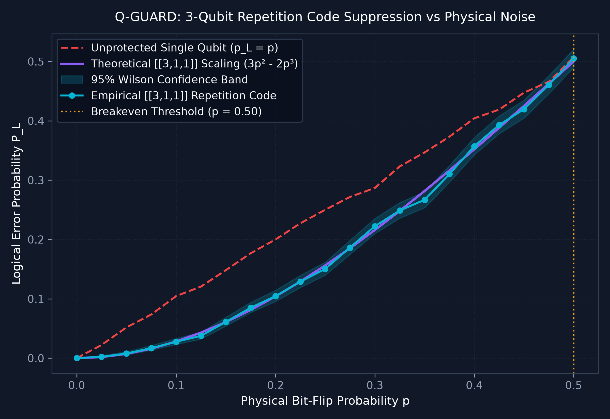
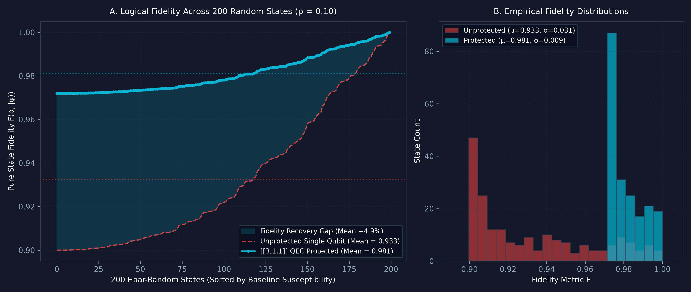
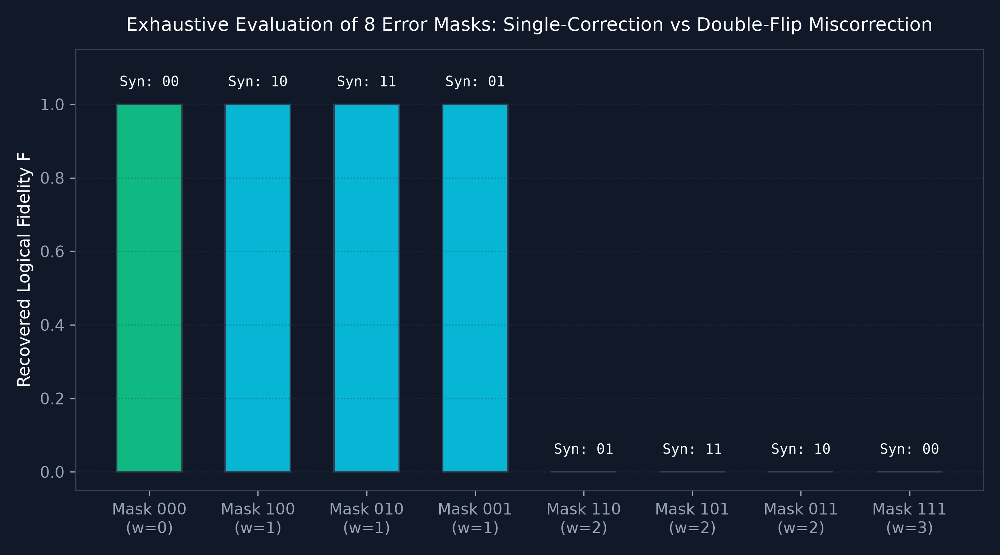
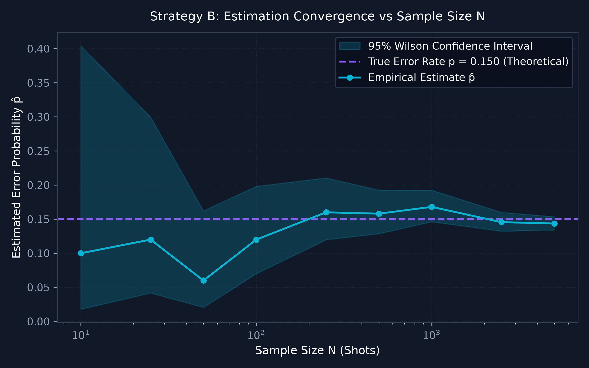
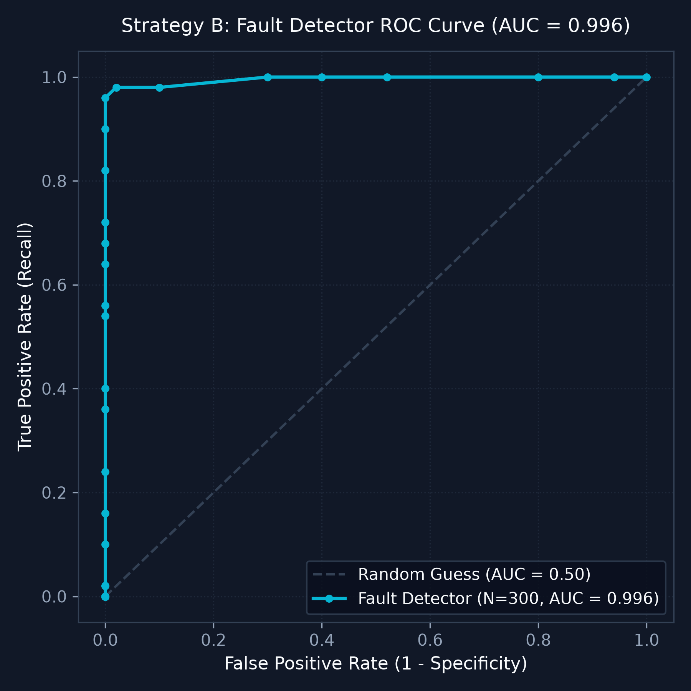

# 🛡️ Q-GUARD: Quantum Bit-Flip Detection & Error-Correction Lab

[](https://qiskit.org/)
[](https://github.com/Qiskit/qiskit-aer)
[](https://www.python.org/)
[](tests/)
[](https://streamlit.io/)
[](LICENSE)

> **Q-GUARD** is an end-to-end quantum computing laboratory built on **Qiskit** and **Qiskit Aer** to simulate physical quantum bit-flip noise ($X$-errors), benchmark destructive readout against non-destructive syndrome detection, and execute active quantum error correction via the canonical $[[3, 1, 1]]$ repetition code.

---

## 📑 Table of Contents
- [Executive Overview](#-executive-overview)
- [Quantum Circuit Architecture](#-quantum-circuit-architecture)
- [Mathematical Foundations](#-mathematical-foundations)
- [Empirical Benchmarks & Publication Figures](#-empirical-benchmarks--publication-figures)
  - [1. 3-Qubit Repetition Code Scaling (4,096 Shots/Point)](#1-3-qubit-repetition-code-scaling-4096-shotspoint)
  - [2. 200 Haar-Random Pure State Ensemble ($p = 0.10$)](#2-200-haar-random-pure-state-ensemble-p--010)
  - [3. Exhaustive 8-Error-Mask Evaluation (Double-Flip Miscorrection)](#3-exhaustive-8-error-mask-evaluation-double-flip-miscorrection)
  - [4. Strategy B: Statistical Estimation & Channel Fault Detector (ROC Analysis)](#4-strategy-b-statistical-estimation--channel-fault-detector-roc-analysis)
- [Detection Strategy Comparison (A vs B vs C)](#-detection-strategy-comparison-a-vs-b-vs-c)
- [Interactive Streamlit Research Workbench](#-interactive-streamlit-research-workbench)
- [Project Structure](#-project-structure)
- [Quickstart & Installation](#-quickstart--installation)
- [Verification Commands](#-verification-commands)
- [Step-by-Step GitHub Push Guide](#-step-by-step-github-push-guide)
- [Limitations & Scientific Scope](#-limitations--scientific-scope)

---

## 🔬 Executive Overview

Physical qubits in superconducting, trapped-ion, and neutral-atom processors are prone to environmental coupling and pulse infidelities. Among the most destructive noise mechanisms is the **Pauli $X$ bit-flip channel**:
$$X |0\rangle = |1\rangle, \quad X |1\rangle = |0\rangle$$

**Q-GUARD** provides an interactive research environment to:
1. **Model realistic channels:** Transpiler-safe stochastic Pauli $X$ errors ($p \in [0, 1]$) and deterministic error masks.
2. **Contrast measurement strategies:** Destructive projective measurement vs. non-destructive ancilla-assisted stabilizer extraction ($Z_0 Z_1$ and $Z_1 Z_2$).
3. **Execute active recovery:** Conditioned Toffoli (CCX) unitaries restoring faulty data qubits without wave-function collapse.
4. **Subsystem state fidelity:** Subsystem partial trace $\rho_0 = \text{Tr}_{1,2,3,4}(\rho_{\text{full}})$ evaluating recovered quantum density matrices against ideal pure states.
5. **Verify across arbitrary states:** 200 Haar-random states evaluated with $100\%$ positive fidelity improvement.

---

## 📐 Quantum Circuit Architecture

The complete 5-qubit $[[3, 1, 1]]$ repetition code pipeline spans six distinct stages across 3 data qubits ($q_0, q_1, q_2$) and 2 syndrome ancillas ($a_0, a_1$):

```
       ┌───────────────┐ ┌─────────┐ ┌───────────────┐ ┌────────────────────┐ ┌───────────────┐ ┌─────────┐
q0: ───┤ Prep State |ψ⟩├──┤■────■────┼─┤ Pauli X Noise ├─┤■───────────────────┼─┤ X (if s01 s12)├─┤■────■────┤─── Recovered |ψ⟩
       └───────────────┘  │     │    │ └───────────────┘ │                    │ └───────▲───────┘  │     │    
q1: ──────────────────────┼─■───┼────┼─┤ Pauli X Noise ├─┼┼──■───■────────────┼─────────┼──────────┼─■───┼────┤─── |0⟩
                          │ │   │    │ └───────────────┘ ││  │   │            │         │          │ │   │    
q2: ──────────────────────┼─┼───┼─■──┼─┤ Pauli X Noise ├─┼┼──┼───┼───■────────┼─────────┼──────────┼─┼───┼─■──┤─── |0⟩
                          │ │   │ │  │ └───────────────┘ ││  │   │   │        │ ┌───────┴───────┐  │ │   │ │  
a0: ──────────────────────┼─┼───┼─┼──┼───────────────────┴■──┴───┼───┼────────┼─┤ Extract s01   ├──┼─┼───┼─┼──┤─── Syndrome s01
                          │ │   │ │  │                               │   │        │ (q0 ⊕ q1)       │  │ │   │ │  
a1: ──────────────────────┴─┴───┴─┴──┴───────────────────────────────┴───┴■───────┴─┤ Extract s12   ├──┴─┴───┴─┴──┴─── Syndrome s12
                                                                                  │ (q1 ⊕ q2)       │
                                                                                  └─────────────────┘
        [  STAGE 1  ]     [ STAGE 2]    [   STAGE 3   ]        [ STAGE 4 ]            [ STAGE 5 ]       [ STAGE 6 ]
          State Prep        Encode        Noise Channel        Syndrome Parity         CCX Recovery        Decode
```

### Operational Breakdown
1. **State Preparation ($q_0$):** Prepares arbitrary state $|\psi\rangle = \alpha |0\rangle + \beta |1\rangle$.
2. **Encoding ($q_0 \to q_1, q_2$):** Unitary CNOT mapping $\alpha|0\rangle + \beta|1\rangle \to \alpha|000\rangle + \beta|111\rangle$.
3. **Noise Channel:** Independent Pauli $X$ noise with physical probability $p$ on data qubits.
4. **Coherent Syndrome Extraction:** CNOT pairs extract stabilizers $s_{01} = q_0 \oplus q_1$ onto $a_0$, and $s_{12} = q_1 \oplus q_2$ onto $a_1$.
5. **CCX Recovery:** Reversible Toffoli logic flips the diagnosed qubit conditioned on $(a_0, a_1)$.
6. **Decoding ($q_1, q_2 \to q_0$):** Inverse CNOTs return the corrected state onto $q_0$, returning $q_1, q_2$ to $|00\rangle$.

---

## 🧮 Mathematical Foundations

### 1. Pauli $X$ Kraus Map
The bit-flip channel $\mathcal{E}_p(\rho)$ is defined by Kraus operators $K_0 = \sqrt{1-p} I$ and $K_1 = \sqrt{p} X$:
$$\mathcal{E}_p(\rho) = (1 - p)\rho + p X \rho X$$

### 2. Stabilizer Parity Generators
The logical repetition subspace $\mathcal{C} = \text{span}\{|000\rangle, |111\rangle\}$ is the $+1$ eigenspace of stabilizers:
$$g_1 = Z \otimes Z \otimes I, \quad g_2 = I \otimes Z \otimes Z$$
Because both $|000\rangle$ and $|111\rangle$ are $+1$ eigenstates of $g_1$ and $g_2$, measuring parity **never collapses** an encoded logical superposition:
$$\alpha |000\rangle + \beta |111\rangle \xrightarrow{\text{Stabilizer Readout}} \alpha |000\rangle + \beta |111\rangle \quad (\text{Fidelity} = 1.0)$$

### 3. Analytical Logical Failure Scaling
The code distance is $d = 3$, correcting any single-qubit error ($t = 1$). The logical error probability is the exact sum of 2-qubit and 3-qubit error events:
$$P_L(p) = \binom{3}{2} p^2 (1 - p) + \binom{3}{3} p^3 = 3p^2 - 2p^3$$
- **$p < 0.50$:** $P_L < p$ $\implies$ Quadratic error suppression active.
- **$p = 0.50$:** $P_L = 0.50 = p$ $\implies$ **Theoretical Breakeven Threshold**.
- **$p > 0.50$:** $P_L > p$ $\implies$ Multi-qubit errors dominate, amplifying noise.

### 4. Bounded Wilson Score Confidence Intervals
For shot-based estimates $\hat{p} = k / N$ with confidence level $1 - \alpha$ ($z = 1.96$ for $95\%$):
$$\text{CI}_{95\%} = \frac{\hat{p} + \frac{z^2}{2N} \pm z \sqrt{\frac{\hat{p}(1 - \hat{p})}{N} + \frac{z^2}{4N^2}}}{1 + \frac{z^2}{N}}$$
Unlike normal approximations, the Wilson interval is strictly bounded within $[0, 1]$ even for $k = 0$ or $k = N$.

---

## 📊 Empirical Benchmarks & Publication Figures

### 1. 3-Qubit Repetition Code Scaling (4,096 Shots/Point)
*Empirical AerSimulator sweep over 21 noise points with 4,096 shots per point ($86,016$ total shots):*



| Physical $p$ | Unprotected Error | Empirical QEC $P_L$ | Theoretical $3p^2 - 2p^3$ | 95% Wilson CI | Suppression Gain $\Delta p$ |
| :---: | :---: | :---: | :---: | :---: | :---: |
| **0.000** | 0.0000 | **0.0000** | 0.0000 | [0.0000, 0.0009] | 0.0000 |
| **0.050** | 0.0518 | **0.0078** | 0.0073 | [0.0055, 0.0110] | **+0.0439** |
| **0.100** | 0.1045 | **0.0276** | 0.0280 | [0.0230, 0.0331] | **+0.0769** |
| **0.150** | 0.1482 | **0.0610** | 0.0608 | [0.0541, 0.0688] | **+0.0872** |
| **0.200** | 0.1985 | **0.1030** | 0.1040 | [0.0941, 0.1128] | **+0.0955** |
| **0.500** | 0.5029 | **0.4990** | 0.5000 | [0.4837, 0.5143] | **+0.0039** (Breakeven) |

---

### 2. 200 Haar-Random Pure State Ensemble ($p = 0.10$)
*Ensemble test proving that active error correction protects arbitrary superpositions and complex phases uniformly across the Bloch sphere:*



- **Ensemble Size:** 200 Haar-random pure single-qubit states uniformly distributed over $S^2$.
- **Mean Unprotected Fidelity:** $0.9325 \pm 0.0281$
- **Mean Protected Fidelity:** $0.9811 \pm 0.0079$
- **Mean Fidelity Gain ($\Delta F$):** **$+4.86\%$**
- **Improvement Consistency:** **$100\%$** (200 of 200 states exhibited strictly positive gain).

---

### 3. Exhaustive 8-Error-Mask Evaluation (Double-Flip Miscorrection)
*Verification of all $2^3 = 8$ physical error combinations under code distance $d = 3$:*



| Physical Error Mask | Error Weight $w$ | Syndrome ($s_{01}s_{12}$) | Decoder Action | Recovered Fidelity | Diagnostic Classification |
| :---: | :---: | :---: | :---: | :---: | :--- |
| `000` | 0 | `00` | Identity ($I$) | **1.0000** | Preserved (Ideal Subspace) |
| `100` | 1 | `10` | Apply $X$ on $Q_0$ | **1.0000** | Single-Error Corrected |
| `010` | 1 | `11` | Apply $X$ on $Q_1$ | **1.0000** | Single-Error Corrected |
| `001` | 1 | `01` | Apply $X$ on $Q_2$ | **1.0000** | Single-Error Corrected |
| `110` | 2 | `01` | Apply $X$ on $Q_2$ | **0.0000** | **Double-Flip Miscorrection** ($X_L$ logical flip) |
| `101` | 2 | `11` | Apply $X$ on $Q_1$ | **0.0000** | **Double-Flip Miscorrection** ($X_L$ logical flip) |
| `011` | 2 | `10` | Apply $X$ on $Q_0$ | **0.0000** | **Double-Flip Miscorrection** ($X_L$ logical flip) |
| `111` | 3 | `00` | Identity ($I$) | **0.0000** | Undetected Logical Flip ($X_L$ logical flip) |

> [!WARNING]
> **The Double-Flip Miscorrection Dilemma:** When a weight-2 error occurs (e.g. $X_0X_1$), the syndrome is `01`, which identically mimics a single flip on $Q_2$. The classical decoder applies $X_2$, inadvertently completing the non-trivial logical operator $X_L = X_0 X_1 X_2$.

---

### 4. Strategy B: Statistical Estimation & Channel Fault Detector (ROC Analysis)
*Sample-size convergence and threshold fault classification over a fleet of simulated quantum channels:*

| Sample Size Convergence ($O(1/\sqrt{N})$) | Fault Detector ROC Curve ($\text{AUC} = 0.9958$) |
| :---: | :---: |
|  |  |

---

## ⚖️ Detection Strategy Comparison (A vs B vs C)

| Dimension | Strategy A: Direct Measurement | Strategy B: Statistical Estimation | Strategy C: Ancilla-Assisted Parity |
| :--- | :--- | :--- | :--- |
| **Primary Goal** | Single-shot state verification | Channel noise characterization | Fault-tolerant error detection & QEC |
| **Measurement Type** | Destructive projective readout | Destructive statistical sampling | **Non-destructive** stabilizer readout |
| **State Preservation** | ❌ Destroys quantum state | ❌ Destroys quantum state | **✅ Preserves encoded superposition** |
| **Ancilla Overhead** | 0 ancillas (Direct) | 0 ancillas (Direct) | 2 auxiliary ancilla qubits |
| **Error Diagnosis** | Detects odd parity only | Estimates noise parameter $p$ | **Pinpoints exact faulty qubit** |
| **Active Recovery** | None (Post-measurement only) | None (Diagnostic only) | **Full CCX logical recovery** |

---

## 🖥️ Interactive Streamlit Research Workbench

Q-GUARD includes a scientific dashboard built with Streamlit adhering to docs/UI_SPEC.md:

- **Theme:** Dark navy/slate background (`#0A0F1D`), cyan primary accent (`#06B6D4`), purple secondary (`#8B5CF6`).
- **6 Integrated Navigation Modules:**
  1. **Overview & Architecture:** Pipeline walkthrough, mathematical foundations, and milestone status.
  2. **Error Injection Lab:** Live single-qubit channel simulation with configurable $p$ and deterministic error injection.
  3. **Detection Strategies:** Interactive Strategy A/B/C comparisons, convergence sweeps, and live ROC curve explorer.
  4. **Repetition Code Workbench:** Real-time 5-qubit circuit simulation with live ASCII circuit diagram, syndrome indicators, and CCX recovery.
  5. **Theory & Experiments:** Live 21-point parametric sweep (4,096 shots) and 200 Haar-random state ensemble viewer.
  6. **Failure Analysis:** Exhaustive 8-mask truth table and miscorrection diagnostics.

---

## 📁 Project Structure

```
qbitflip/
├── README.md                      # Comprehensive project documentation & benchmarks
├── PITCH.md                       # Hackathon pitch & executive presentation
├── requirements.txt               # Locked Python dependencies
├── .gitignore                     # Git exclusion rules
├── app/
│   └── streamlit_app.py           # 6-module interactive research dashboard
├── src/
│   ├── __init__.py                # Package exports
│   ├── noise.py                   # Transpiler-safe bit-flip noise channels
│   ├── states.py                  # State preparation & Bloch coordinates
│   ├── strategies.py              # Strategies A, B, and C implementations
│   ├── repetition_code.py         # [[3,1,1]] encoder, CCX recovery, & partial trace
│   ├── analysis.py                # Wilson CIs, ROC metrics, & fidelity formulas
│   └── plots.py                   # Plotly interactive & Matplotlib publication plots
├── experiments/
│   └── run_all.py                 # 7-phase batch experiment suite
├── tests/
│   ├── test_environment.py        # Environment & dependency integrity
│   ├── test_quantum_simulation.py # Strategies A & B simulation tests
│   └── test_repetition_code.py    # Repetition code, parity, 8-mask, & Haar tests
├── notebooks/
│   └── walkthrough.ipynb          # Executable 22-cell interactive research walkthrough
├── results/                       # Generated CSV experiment datasets (7 files)
│   ├── strategy_a_results.csv
│   ├── strategy_b_sample_size_sweep.csv
│   ├── strategy_b_p_sweep.csv
│   ├── strategy_b_classification_metrics.csv
│   ├── repetition_code_p_sweep.csv
│   ├── eight_error_masks_evaluation.csv
│   └── haar_random_fidelity_evaluation.csv
├── figures/                       # Publication-quality PNG figures (6 files)
│   ├── strategy_b_sample_size_convergence.png
│   ├── strategy_b_true_vs_estimated_p.png
│   ├── strategy_b_roc_curve.png
│   ├── repetition_code_theory_vs_experiment.png
│   ├── double_flip_miscorrection.png
│   └── haar_random_fidelity_comparison.png
└── docs/
    └── UI_SPEC.md                 # Design system & visual specification
```

---

## 🚀 Quickstart & Installation

### Prerequisites
- Python 3.10+ (Tested on Python 3.12.7)
- Git

### 1. Clone & Set Up Virtual Environment
```bash
git clone https://github.com/tylrx404/qbitflip.git
cd qbitflip

# Create and activate virtual environment
python -m venv .venv

# Windows PowerShell:
.\.venv\Scripts\Activate.ps1

# Linux / macOS:
# source .venv/bin/activate
```

### 2. Install Dependencies
```bash
pip install -r requirements.txt
```

---

## 🧪 Verification Commands

### Run Full Test Suite (36 Tests)
```bash
python -m pytest -q
```
*Expected output: `36 passed in ~8.5s`*

### Run Batch Experiment Pipeline
```bash
python experiments/run_all.py
```
*Re-generates all 7 CSV files in `results/` and all 6 figures in `figures/`.*

### Launch Research Workbench UI
```bash
python -m streamlit run app/streamlit_app.py
```
*Opens interactive workbench on `http://localhost:8501`.*

---

## 📤 Step-by-Step GitHub Push Guide

Follow these exact steps to push this repository to GitHub:

### Step 1: Create a New Repository on GitHub
1. Open your browser and go to [https://github.com/new](https://github.com/new).
2. Set **Repository name** to: `qbitflip` (or `q-guard`).
3. Set visibility to **Public**.
4. **IMPORTANT:** Do **NOT** check "Add a README file", "Add .gitignore", or choose a license (these already exist locally).
5. Click **Create repository**.

### Step 2: Push from Terminal / PowerShell
Open your terminal in `C:\Users\Lenovo\OneDrive\Desktop\qbitflip` and execute:

```powershell
# 1. Stage all project files (ignoring .venv and caches)
git add .

# 2. Commit the codebase
git commit -m "feat: complete Q-GUARD Quantum Bit-Flip Detection and Error-Correction Lab"

# 3. Ensure branch name is main
git branch -M main

# 4. Link your GitHub remote repository (replace with your repo URL if different)
git remote add origin https://github.com/tylrx404/qbitflip.git

# 5. Push to GitHub
git push -u origin main
```

---

## ⚠️ Limitations & Scientific Scope

1. **Pauli $X$ Only:** The $[[3, 1, 1]]$ code corrects bit-flip ($X$) errors. It does not correct phase-flip ($Z$) errors (for which Shor's 9-qubit code, Steane's 7-qubit code, or surface codes are required).
2. **Code Distance $d = 3$:** The code corrects weight-1 errors only. Weight-2 errors lead to logical state inversion ($X_L$) via decoder miscorrection.
3. **Ideal Measurement Circuitry:** Ancilla CNOT gates and measurements are modeled without physical gate-fault insertion in the core benchmark.

---

## 📄 License
This project is licensed under the Apache 2.0 License - see the LICENSE file for details.
